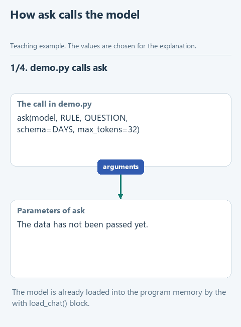

# Lesson 1. The model inside the program

[Lesson source files](../exercises/lesson-01-runtime/README.md) / [Hints next to the code](../exercises/lesson-01-runtime/TASK.md)

> **Where we are.** We are building a shared module through which every lesson of the course will reach the local model. Today we write its `ask` function.
> **From the main course:** two messages with the `system` and `user` roles from `build_messages`, answer parsing from `extract_answer`, the optional lesson on running a model from Python.
> **New:** the model lives in our program's memory, one loading module for the whole course, an answer strictly by a JSON schema.
> `question -> ask -> [messages -> model in program memory] -> text or dictionary`

Back to the customer's question from the main course: "How many days do I have to return an item?" and the policy clause "Returns are accepted within 14 days." Back then the program sent this data over the network: `send_live` made an HTTP request to OpenRouter, VseGPT or Ollama, and the model ran in a separate application. To get an answer, that application had to be running and reachable.

Now the model becomes part of our program. The model file is loaded into its memory, the call is an ordinary Python function, and not a single byte goes outside. This design is chosen when the program must work without a network, when you cannot install a separate service on the computer, or when the data must not leave the machine. In the [optional lesson of the main course](https://github.com/polar-byter/agent-harness-workshop-en/blob/main/course/02-note-assistant/extra-local.md) we already tried running a model this way. In stage 2 it is the main way, and today we make it convenient for all the following lessons.

## Who does the computing

The llama.cpp engine computes, and the `llama-cpp-python` library gives access to it from Python. There is a ready build for Windows, so nothing has to be compiled. The model is stored in a GGUF file: inside are the trained parameters and the information needed to load them.

The main model of the course is Qwen3-1.7B in the Q8_0 variant, a file of about 1.8 GB, from the [official Qwen repository](https://huggingface.co/Qwen/Qwen3-1.7B-GGUF). In the main course we used the smaller Qwen3-0.6B, but it is a bit weak for the stage 2 tasks: when the course was prepared, it sorted nine of the twelve cat-journal entries from lesson 2 correctly, and Qwen3-1.7B eleven. If your laptop is very weak, you can still take 0.6B; the way to do it is described below. On the computer where the course was checked, a short answer from 1.7B took about a second; on an ordinary laptop it takes a few seconds.

## One environment for the whole course

In the main course every lesson managed with Python's standard library. Now we need external packages, and installing them again in every lesson folder takes a long time. So we create one virtual environment for the whole course and choose it in PyCharm in every lesson.

Download [the lesson archive](../downloads/lesson-01-runtime.zip?raw=true), extract it with **Extract All** and open the `lesson-01-runtime` folder in PyCharm with **File -> Open**.

1. Open **File -> Settings -> Project: lesson-01-runtime -> Python Interpreter** and click **Add Interpreter -> Add Local Interpreter**.
2. Choose **Virtualenv Environment** and the **New** option. In **Location** enter `C:\Users\Name\agent-venv`, where `Name` is your user folder. In **Base interpreter** choose Python 3.14. Click **OK**.
3. Open **View -> Tool Windows -> Terminal**. `(agent-venv)` should appear at the start of the line. If it does not, close the terminal tab and open a new one. Enter:

```powershell
python -m pip install --only-binary=:all: -r requirements.txt
```

The `--only-binary=:all:` flag allows only ready packages: if there is no suitable one for your system, the installation stops with a clear error instead of starting to build C++. `requirements.txt` holds the address of the `llama-cpp-python` 0.3.36 build for Windows x64, which works with any version of Python 3.

4. Open `check_install.py` and choose **Run 'check_install'**. The Run window shows the path to Python, the line `Library loaded: 0.3.36` and the models folder. If the terminal reported a successful installation but `check_install` did not find the library, the project and the terminal use different interpreters: check step 1.

In the following lessons you do not create the environment again. In the same **Add Local Interpreter** window choose **Virtualenv Environment -> Existing** and point to `C:\Users\Name\agent-venv\Scripts\python.exe`.

## Download the model

Open `get_models.py` and choose **Run 'get_models'**. The program downloads `Qwen3-1.7B-Q8_0.gguf` into `C:\Users\Name\agent-models` and prints the percentage. This folder is shared by the whole course: the following lessons take the model from there and do not download it again.

<details>
<summary>A small model or another disk</summary>

To download Qwen3-0.6B instead of 1.7B, open **Run -> Edit Configurations...**, choose `get_models`, type the word `small` into **Script parameters** and run again. If the shared folder has only the small model, the course uses it.

To keep the models on another disk, set the `AGENT_MODELS_DIR` environment variable to the folder path, for example `D:\agent-models`: **Start -> Edit environment variables for your account -> New**. Then restart PyCharm.

</details>

## Look at the shared module

Open `local_llm.py`. This file sits unchanged in every starter of the course. At the top is the `MODELS` dictionary: for each course model, the file name, the address and the approximate size. `models_dir` returns the shared models folder, and `download` downloads missing files.

Below is `load_chat`. It is used in a `with` block:

```python
with load_chat() as model:
    print(ask(model, RULE, QUESTION))
```

Inside `load_chat` a `Llama` object is created - it is how we reach the loaded model. `n_gpu_layers=0` keeps the computing on the processor, and `n_ctx=4096` sets the context size in tokens. When the program leaves the `with` block, `load_chat` frees the memory, even if an error happened on the way. The model is loaded once, and inside the block you can call it as often as you like.

`clean_answer` parses what the model returned. The result of the call is a dictionary with a `choices` field, roughly like this:

```python
{'choices': [{'finish_reason': 'stop', 'message': {'content': 'You can return an item within 14 days.'}}]}
```

`clean_answer` checks that generation ended by itself (`finish_reason` is `'stop'`) rather than being cut off at the length limit, removes the empty service block `<think>...</think>` that Qwen3 sometimes adds, and returns a string. This is the same job `extract_answer` did in the main course.

## An answer by a JSON schema

Often we need not text but a value the program can work with: a number of days, a category, yes or no. You can ask the model to "answer in JSON", but a small model sometimes adds an explanation or forgets a quote, and `json.loads` fails.

A local model has a more reliable way. We pass a JSON schema - a description of the allowed answer:

```python
DAYS = {'type': 'object', 'properties': {'days': {'type': 'integer'}}, 'required': ['days']}
```

The schema says: the answer is an object with a required `days` field holding an integer. The library turns the schema into a grammar, and when choosing each next token the model can take only a token that does not break the schema. So the answer is always parsable JSON like `{"days": 14}`. Keep the boundary in mind: the schema guarantees the form of the answer, and checking that the number is right is still our job.

If you took the main course, this resembles `dispatch_tool`: there the program rejected a tool that was not on the list. Here an invalid answer cannot even appear.

## Your turn

`ask` receives the loaded model `model`, the rule `instruction`, the data `text` and, if needed, the schema `schema`. The start is ready: the `settings` dictionary holds the token sampling settings from `SAMPLING` and the length limit, and `response_format` is added when a schema is passed. Replace the line `raise NotImplementedError(...)` with the fragment below and fill in the two gaps:

```python
    messages = [
        {'role': 'system', 'content': instruction + NO_THINK},
        {'role': 'user', 'content': ...},
    ]
    response = model.create_chat_completion(messages=..., **settings)
    answer = clean_answer(response)
    if schema is not None:
        return json.loads(answer)
    return answer
```

1. In the second message put `text`: the customer's question together with the policy clause.
2. Pass the `messages` list built just above to `messages=`.

The messages are built the same way as in `build_messages` of the main course: the rule in the `system` role, the data in the `user` role. `NO_THINK` is added to the rule - the Qwen3 command `/no_think`, so the model answers straight away without long reasoning. The two asterisks in `**settings` unpack the dictionary into named arguments: `max_tokens=256`, `temperature=0.7` and the rest. If a schema was passed, `json.loads` turns the string `'{"days": 14}'` into the dictionary `{'days': 14}`, and the function returns a dictionary; otherwise it returns a string.

The whole fragment sits inside the function with a four-space indent. The lines of the `messages` list are indented four more, and the final `return answer` is at the same level as `if`.

## Guess before running

`demo.py` asks the model the same question twice. The first time without a schema, the second time with the `DAYS` schema. What will the `type:` line print after the second answer: `str` or `int`?

## Run it

First open `demo_check.py` and choose **Run 'demo_check'**. Instead of the model, a stand-in object `ExampleModel` answers here: it remembers which messages it was given and returns a prepared text. So the check works without a model and even without the library installed. Once `ask` is done, Run shows:

```text
Offline check: You can return an item within 14 days.
```

If you see `Complete ask...`, the stub is still in place. A message like `Pass text in the second message` tells you which gap is filled in wrong.

Now open `demo.py` and choose **Run 'demo'**. You will see `Loading Qwen3-1.7B-Q8_0.gguf...`, then the model's answer, the answer time and the answer by the schema:

```text
Model answer: You have 14 days to return an item.
Answer time, s: 1.1
Answer by schema: {'days': 14} - type: int
```

The words of the first answer will be different for you, and the time depends on the computer. The second answer is a dictionary with a number: the `"integer"` schema set the type `int`.

## Try to break it

**Change the source.** In `demo_check.py` find `QUESTION` and replace "14 days" with "30 days". Run `demo.py`: both answers should say 30. If the model keeps writing 14, it is not answering from the supplied clause, and that is a reason to compare the answer with the source, as we did in the main course. Put 14 back.

**Cut the limit.** In `demo.py`, add the argument `max_tokens=5` to the first `ask` call. The model will not finish the sentence, `finish_reason` will be `'length'`, and instead of a fragment `clean_answer` raises the error `Generation did not finish`. This is how the program tells a finished answer from a cut-off one. Remove the argument.

**Change the type in the schema.** In `DAYS` replace `'integer'` with `'string'`. Now the second answer is a string of type `str`. When the course was prepared, the model wrote `{"days": "Do you have to return an item within 14 days?"}` in one run, and in two other runs it kept writing a sentence inside the string until it hit the 32-token limit, so `clean_answer` raised `Generation did not finish`. The schema allowed any string, and the model filled it with words instead of a number. With the `'integer'` type such an answer is impossible. Put `'integer'` back.

## What we have now

`ask` is the only door to the language model in the whole course: a rule and data go in, text or a dictionary comes out. In the following lessons `local_llm.py` sits ready in the starter, and you call `ask` from your own functions. If you recall the agent loop from the main course, `ask` takes the place of `send_live` in it: it receives messages and returns the model's decision, and the program still decides what to do with that decision.



[Static version](../assets/lesson-01-ask.png).

Next: [lesson 2. The cat's mischief journal](02-cat-journal.md) - the first application with a window and a JSON schema in practice.
