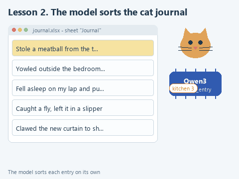

# Lesson 2. The cat's mischief journal

[Lesson source files](../exercises/lesson-02-cat-journal/README.md) / [Hints next to the code](../exercises/lesson-02-cat-journal/TASK.md)

> **Where we are.** The first application with a window: a utility reads a journal from Excel, the model sorts the entries into categories and writes a bulletin. Today we write `classify_entry`, which sorts one entry.
> **From the main course:** a log as a way to reconstruct later what happened; checking on a set of test examples.
> **New:** a tkinter window, reading and writing Excel with openpyxl, classification with a list of allowed categories in a JSON schema.
> `Excel -> read_journal -> [classify_entry -> ask with a schema] -> categories -> bulletin -> "Review" sheet`

Imagine a family with a cat named Whiskers. To stop arguing about who is to blame for the broken mug, the family started a journal in Excel: the date, who wrote it down, what happened. In a week it collected twelve entries, from a stolen meatball to a concert at three in the morning. The family wants to know what Whiskers does most often and to read a short bulletin over dinner, in the style of the evening news.

The task is a joke, but it works like a real one. The Avito analysts from the introduction labeled about 1,300 support requests this way: for each record the model picks a category from a predefined list, and then people look at the distribution and go through the errors. The cat makes this mechanism easy to try with your own hands: there are few entries, all of them clear, and you will spot a model error right away.

## Open the starter

Download [the lesson archive](../downloads/lesson-02-cat-journal.zip?raw=true), extract it and open the `lesson-02-cat-journal` folder with **File -> Open**. In the interpreter settings choose the shared course environment: **Add Local Interpreter -> Virtualenv Environment -> Existing** and `C:\Users\Name\agent-venv\Scripts\python.exe`. If you skipped the environment in lesson 1 because the library was already installed in another interpreter, choose that one. In the PyCharm terminal install the lesson's dependencies; openpyxl is added to the earlier ones:

```powershell
python -m pip install --only-binary=:all: -r requirements.txt
```

The model was downloaded in lesson 1. If you start the course here, run `get_models.py`.

| File | What is in it |
|---|---|
| `data/journal.xlsx` | The journal: twelve entries about Whiskers's mischief |
| `journal_io.py` | Reading and writing Excel; no model here |
| `journal_ai.py` | Categories, sorting an entry with the model and the bulletin. We write `classify_entry` here |
| `app.py` | The utility window |
| `demo_check.py` | A check of your function without a model |
| `demo.py` | Sorting the journal with the real model in the Run window |

## Look at the data

Open `data/journal.xlsx` in Excel. The "Journal" sheet has three columns:

| Date | Written by | What happened |
|---|---|---|
| 2026-10-03 | Mom | Stole a meatball from the table while everyone was watching TV |
| 2026-10-03 | Dad | Yowled outside the bedroom door at three in the morning |
| 2026-10-04 | Grandma | Fell asleep on my lap and purred for a whole hour |

`read_journal` from `journal_io.py` opens the file with the openpyxl library, skips the header row and creates a dictionary for each row with text:

```python
{'date': '2026-10-03', 'author': 'Mom', 'text': 'Stole a meatball from the table while everyone was watching TV'}
```

If the date cell holds a real Excel date rather than text, openpyxl returns a date object, and `as_text` turns it into the string `'2026-10-03'`. The function skips empty rows of the journal.

## How the utility is built

The code is split into three files by one simple rule: each file knows only its own business. `journal_io.py` can read and write Excel but knows nothing about the model. `journal_ai.py` sorts entries with the model and knows nothing about windows. `app.py` draws the window and calls the functions of the other two files when buttons are pressed.

Thanks to this, your function can be checked without a window and without a model, and the window can be redrawn without touching the sorting. We look at this split into layers in more detail in lesson 5, on a web service.

<details>
<summary>Why the window does not freeze while the model is thinking</summary>

Sorting twelve entries together with the bulletin can take tens of seconds on a laptop. If it is called straight from a button handler, the window stops responding: tkinter handles clicks and redrawing in the same thread where the code runs. So `app.py` runs the sorting in a separate thread (`threading.Thread`), which puts progress messages into a `queue.Queue`. Every 100 milliseconds the window looks into the queue through `window.after` and updates the label and the table. tkinter does not allow changing window elements from another thread, so all drawing happens in the main thread.

</details>

## Categories with explanations

Open `journal_ai.py`. At the top is the dictionary of categories:

```python
CATEGORIES = {
    'kitchen': 'stole or tried to steal food',
    'damage': 'spoiled something: tore, broke, knocked over, stained',
    'noise': 'kept people awake, yowled loudly, woke someone up',
    'affection': 'cuddled, purred, slept next to someone',
    'hunting': 'caught insects, birds or toys, chased something',
}
```

The rule `CLASSIFY_RULE` is assembled from this dictionary: the model gets the list of categories, each with a short explanation, and a severity scale from 1 to 3. The explanations are not decoration. When the course was prepared, Qwen3-1.7B sorted seven of the twelve entries correctly by the category names alone, and eleven with the explanations. Writing good explanations is the job of a person who knows the subject; in a real task that is usually an analyst.

## Your turn

`classify_entry` already checks for an empty entry. Replace the line `raise NotImplementedError(...)` with the fragment below and fill in the two gaps:

```python
    schema = {
        'type': 'object',
        'properties': {
            'category': {'type': 'string', 'enum': ...},
            'severity': {'type': 'integer', 'enum': [1, 2, 3]},
        },
        'required': ['category', 'severity'],
    }
    answer = ask(model, CLASSIFY_RULE, ..., schema=schema, max_tokens=64)
    return {'category': answer['category'], 'severity': answer['severity']}
```

1. In the category's `'enum':` put `list(CATEGORIES)`. A list made from a dictionary gives its keys: `['kitchen', 'damage', 'noise', 'affection', 'hunting']`.
2. Pass `text`, the text of the entry, as the third argument of `ask`.

The word `enum` in a schema means "one of the listed values". The model cannot write the category "food" or "mess", however much it wants to: only our five strings are allowed when tokens are chosen. The same goes for severity: only 1, 2 or 3. The `max_tokens=64` limit is more than enough for a short JSON like `{"category": "kitchen", "severity": 1}`. `ask` from lesson 1 returns it already as a dictionary, and we take the two fields we need from it.

## Guess before running

Reread the twelve journal entries. How many of them will the model sort the way you would? Which two or three entries seem debatable to you?

## Run it

Open `demo_check.py` and choose **Run 'demo_check'**. The stand-in model here answers by a keyword, and the check looks at whether you passed the entry text and the list of categories in the schema to the model. Once the function is done:

```text
Offline check: Stole a meatball from the table while everyone was watching TV -> kitchen, severity 1
```

Now **Run 'demo'**. The program loads the model and sorts all the entries. This is what one of the runs looked like when the course was prepared:

```text
  kitchen | 3 | Stole a meatball from the table while everyone was watching TV
    noise | 3 | Yowled outside the bedroom door at three in the morning
affection | 1 | Fell asleep on my lap and purred for a whole hour
  hunting | 1 | Caught a fly and left it in Dad's slipper
   damage | 3 | Clawed the new living room curtain to shreds
   ...
   damage | 1 | Slept on the freshly ironed shirts
   ...
affection | 1 | Met me at the door and rubbed against my legs
```

Below the table are the count by category and the family bulletin. The same model writes the bulletin as plain text, without a schema, following the rule `SUMMARY_RULE`.

Finally, open `app.py` and choose **Run 'app'**. A window appears. Click **Open journal**, choose `data/journal.xlsx`, then **Sort entries**. Entry numbers run through the status line, then the table fills with categories and the bulletin appears at the bottom. **Save to Excel** adds a "Review" sheet to the file. Close the file in Excel before saving, or Windows will not let the program overwrite it.

## Check the result

Compare the model's answer with your guess. In the run above there is one error: the model filed the shirts Whiskers slept on under damage. You can follow its logic - a crumpled ironed shirt has to be ironed again - but the family counts it as affection. Look at severity too: the model gave the stolen meatball a 3, "needs a repair or a new purchase". The schema allows only 1, 2 or 3, but it does not make the number sensible. Your run may differ: the token sampling settings allow some randomness.

Disputed cases like this are settled by the explanations. Add the words "or on their clothes" to "affection", and narrow "damage" to "spoiled something for good: tore, broke, knocked over and smashed, stained". When the course was prepared, the addition to "affection" alone was not enough: the model kept choosing damage. Only after "damage" was narrowed did it sort all twelve entries correctly, twice in a row.

This is what work with classification looks like in practice: run a set of entries with known correct answers, find the errors, adjust the category descriptions and run again. In the main course we called such a set test scenarios; it is needed in exactly the same way for labeling requests.

## Try to break it

**Remove the explanations.** In `CLASSIFY_RULE` replace the line with the list of categories with `', '.join(CATEGORIES)`, so the model sees only the names. Run `demo.py` and count the errors. Put it back.

**Remove the list from the schema.** Delete `'enum': list(CATEGORIES)` from the category and run `demo.py`. When the course was prepared, the model kept to the names from the rule even without the list, but now that rests only on its behavior. Change the rule or take another model, and next to "kitchen" the count may show "food", which nothing downstream expects. With the list in the schema an invalid name cannot appear at all, so put `enum` back.

**Add an empty row.** Insert a row in Excel with only the date filled in, save and run `demo.py`. The entry does not get sorted: `read_journal` skips rows without text.

## What we have now

The utility reads a journal from Excel, sorts the entries by a fixed list of categories and saves the result back into the file. Here the model is responsible for one narrow action, and a person checks the labeling against test entries. We will meet the same journal again: in lesson 7 a Telegram bot writes new mischief into it.



[Static version](../assets/lesson-02-journal.png).

Next: [lesson 3. A model that makes decisions](03-decisions.md).
