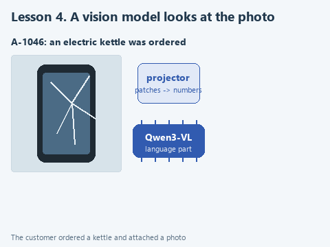

# Lesson 4. A vision model checks the photo

[Lesson source files](../exercises/lesson-04-vision/README.md) / [Hints next to the code](../exercises/lesson-04-vision/TASK.md)

> **Where we are.** A return claim comes with a photo of the item. The vision model says what is in the photo, whether it is the ordered item and whether damage is visible, and the program decides where to send the claim. Today we write `check_photo`, which passes the picture to the model.
> **From the main course:** a person's approval before an important action; the program, not the model, decides.
> **New:** a vision model from two files, a message made of a picture and text, a schema with yes/no fields.
> `claim + photo -> [check_photo: picture + item name -> vision model] -> {item, same_item, damage_visible} -> route_return -> staff`

A customer attaches a photo of the item to a return claim. A store employee sorts such claims: if the photo shows a different item, ask for another photo; if damage is visible, the claim should be handled first; if no damage is visible in the photo, the item will have to be checked when it arrives. The model can do the first sorting, while the decision about refunding money stays with the employee - just as in the main course a code change was applied only after a person approved it.

Dmitry Kolesnikov from Wildberries describes a similar scheme in [an article on moderating product cards](https://habr.com/ru/articles/992716) (in Russian): a vision model that also understands text receives a photo and a question about a violation and answers "yes" or "no". It is not run on the whole stream, only on the images that the main model flagged earlier, to reduce false positives and take load off manual moderation.

## A vision model from two files

We take Qwen3-VL-2B from the [official Qwen repository](https://huggingface.co/Qwen/Qwen3-VL-2B-Instruct-GGUF). It consists of two files. The language part `Qwen3VL-2B-Instruct-Q4_K_M.gguf` (about 1.1 GB) writes the answer, like Qwen3 from the earlier lessons. The projector `mmproj-Qwen3VL-2B-Instruct-Q8_0.gguf` (about 450 MB) turns the picture into a set of vectors that the language part takes instead of words. `load_vision` from `local_llm.py` loads them together.

On the computer where the course was checked, Qwen3-VL-2B took 7 to 10 seconds per photo and answered all five claims of this lesson correctly.

## Open the starter

Download [the lesson archive](../downloads/lesson-04-vision.zip?raw=true), open the `lesson-04-vision` folder in PyCharm and choose the shared course environment. Run `get_models.py`: it downloads the two model files, about 1.6 GB.

| File | What is in it |
|---|---|
| `data/returns.json` | Five claims: order number, item, reason for return, photo file name |
| `data/photos` | Four photos; where they come from is in `SOURCES.md` |
| `photo_check.py` | The rule, the schema, photo preparation and the claim route. We write `check_photo` here |
| `demo_check.py` | A check of the function on a stand-in model |
| `demo.py` | Sorting all the claims with the real model |

## Look at the data

A claim looks like this:

```python
{'order': 'A-1044', 'item': 'sneakers', 'reason': 'wrong size', 'photo': 'mug.jpg'}
```

In this claim the customer ordered sneakers but attached a photo of a mug. This is exactly the kind of mistake the check should catch. In the last claim, A-1046, a photo of a broken smartphone is attached to a kettle.

A message for the vision model is built a little differently from the earlier lessons. The content of the `user` message is not a string but a list of two parts: a picture and text.

```python
{'role': 'user', 'content': [
    {'type': 'image_url', 'image_url': {'url': 'data:image/jpeg;base64,/9j/4AAQSkZJRg...'}},
    {'type': 'text', 'text': 'Ordered item: sneakers'},
]}
```

We pass the picture right inside the message. The ready function `image_to_data_uri` reads the file bytes and writes them as base64 text, and the prefix `data:image/jpeg;base64,` says that a JPEG picture is inside. The file is not uploaded anywhere: the whole string stays in the program's memory.

The model's answer is restricted by the `PHOTO_SCHEMA` schema with four fields: `item` - what is in the photo, `same_item` - whether it is the same item, `damage_visible` - whether damage is visible, `comment` - a short note for the employee. Fields of type `boolean` accept only `true` or `false`, so the program does not have to guess what "probably yes" means. The strings have a maximum length `maxLength`, so the model does not write an essay and run into the limit.

## Your turn

Replace the line `raise NotImplementedError(...)` in `check_photo` with the fragment below and fill in the two gaps:

```python
    messages = [
        {'role': 'system', 'content': PHOTO_RULE},
        {'role': 'user', 'content': [
            {'type': 'image_url', 'image_url': {'url': image_to_data_uri(...)}},
            {'type': 'text', 'text': 'Ordered item: ' + ...},
        ]},
    ]
    response = model.create_chat_completion(
        messages=messages, max_tokens=200, temperature=0.2,
        response_format={'type': 'json_object', 'schema': PHOTO_SCHEMA},
    )
    return json.loads(clean_answer(response))
```

1. Pass `photo`, the path to the photo file, to `image_to_data_uri`.
2. After "Ordered item: " add `ordered_item`, the name of the item from the claim.

Here we call the model directly, without `ask`: `ask` from lesson 1 builds the `user` message from a string, and we need a list of a picture and text. Parsing the answer is the same - `clean_answer` and `json.loads`. The low `temperature=0.2` reduces the randomness of token choice: for a check we need a stable answer, not varied wording.

## Guess before running

Look at the five claims in `data/returns.json` and the photos in `data/photos`. Where will `route_return` send each claim? For which of them can a photo not confirm the reason for the return at all?

## Run it

Open `demo_check.py` and choose **Run 'demo_check'**. The stand-in model always answers that the photo shows a broken smartphone. The check looks at whether the message has the picture first, as `data:image/jpeg;base64,...`, then the item name. Once the function is done:

```text
Offline check: to staff: damage is visible in the photo
```

Now **Run 'demo'**. Loading the two files takes a few seconds, then for each claim the model's answer and the decision appear. This is what a run looked like when the course was prepared, with the comments shortened:

```text
A-1042: electric kettle, reason "does not switch on", photo kettle.jpg
  Model: {'item': 'electric kettle', 'same_item': True, 'damage_visible': False, ...}
  Decision: to staff: no damage visible in the photo, the item needs checking (10 s)
A-1044: sneakers, reason "wrong size", photo mug.jpg
  Model: {'item': 'mug', 'same_item': False, 'damage_visible': False,
          'comment': 'The photo shows a mug with steam, not sneakers.'}
  Decision: ask for another photo: the picture does not show the ordered item (9 s)
A-1046: electric kettle, reason "arrived broken", photo phone.jpg
  Model: {'item': 'phone', 'same_item': False, 'damage_visible': True,
          'comment': 'The phone has a cracked screen.'}
  Decision: ask for another photo: the picture does not show the ordered item (7 s)
```

All five decisions were correct. Note how the decision is made: `route_return` looks only at the `same_item` and `damage_visible` fields, and a person reads the comment. In A-1046 the comment is accurate, but a small model's free text can also be wrong; it is a hint for the employee, and decisions are not built on it.

Claim A-1042 shows the limit of the method: the kettle "does not switch on", and that can never be seen in a photo. The model answered that no damage is visible, and the claim went to an item check.

## Try to break it

**Remove the item field.** In `PHOTO_SCHEMA` delete the line with `'item'` and remove `'item'` from the `required` list, and in `PHOTO_RULE` replace everything before the words "In comment" with: "You help check product photos for return claims. Compare the object in the photo with the ordered item and say whether damage is visible: cracks, chips, broken glass, dents." Run `demo.py` and look at claim A-1046. When the course was prepared, the English version answered correctly even without this field, in two runs out of two, so here the field works as insurance rather than a fix. Watch whether your run differs. The model fills the fields in order, and when it names the object first, the comparison with the order tends to be more accurate. Put the rule and the `item` field back in first place.

**Remove the length limit.** Delete `'maxLength': 200` from the comment, and replace the last sentence of the rule with "Answer in English.". Without a length limit the model may write a comment until it hits the 200-token limit, and then `clean_answer` reports `Generation did not finish`. See how the model behaves for you, and put the limit back.

**Slip in your own photo.** Take a photo of any object at home, save it as JPEG in `data/photos` and add a claim to `returns.json`. Check whether the model copes with your lighting and background.

## What we have now

The vision model sorted the claims in three directions, and the decision about money stayed with the employee. The program relies only on the yes/no fields, the order of fields in the schema helps the model look at the object first and compare afterwards, and the model's free text goes to a person as a hint.



[Static version](../assets/lesson-04-photo.png).

Next: [lesson 5. The model in a web service](05-movie-service.md).
