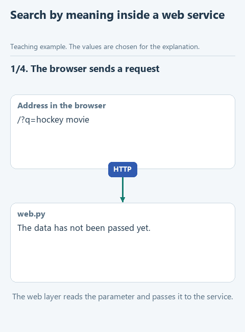

# Lesson 5. The model in a web service

[Lesson source files](../exercises/lesson-05-movie-service/README.md) / [Hints next to the code](../exercises/lesson-05-movie-service/TASK.md)

> **Where we are.** A home movie catalog already runs in the browser and searches by words. We add search by meaning with an embedding model, without rewriting the rest of the service. Today we write `SemanticSearch.find` and connect it in `run.py`.
> **From the main course:** `find_notes` as the retrieval step before the answer; `send_live` as one entry point to different model services.
> **New:** embeddings and cosine similarity, a service split into layers, a strategy, an adapter, dependency injection and a composition point.
> `browser -> web.py -> CatalogService -> search -> [SemanticSearch: query -> vector -> closeness] -> movies -> page`

Imagine a home movie catalog: in the evenings the family chooses what to watch and records the films they liked with a short description. The catalog already works in the browser: a list of movies, tags, a form to add a movie and a search. The search, though, is simple - by words. For the query "hockey movie" it will not find "Miracle", because its description talks about a team, the ice and a puck but never uses the word "hockey". Let us build search by meaning into the service.

A real service described by Anatoly in [an article on Habr](https://habr.com/ru/articles/945404/) (in Russian) works the same way. It searches the history of support tickets inside a closed network: tickets become embeddings, the question does too, the most similar ones are chosen by cosine similarity, and the web service is written in Flask. Their data lives in MySQL, ours in SQLite.

The search itself takes a few lines. The main thing in this lesson is how the model enters an application that existed without it. If the service is split into clear parts, one new class and one line at the place where the parts are connected are enough.

## A model that turns text into numbers

Search by meaning needs an embedding model. It receives text and returns a list of numbers - a vector; for this lesson's model it holds 1024 numbers. It is trained so that texts with close meaning get close vectors: the query "hockey movie" ends up near the description of a film about a hockey team, and "a gentle cartoon before bed" near "The Snowman".

The closeness of two vectors is conveniently measured by the cosine of the angle between them: 1 means they point the same way, around 0 means they are unrelated. If every vector is first brought to length 1, the cosine is easy to compute: multiply the numbers in pairs and add them up. For two short vectors `[0.6, 0.8]` and `[0.8, 0.6]` that is `0.6 * 0.8 + 0.8 * 0.6 = 0.96`, very close.

Search in RAG systems rests on embeddings: the program finds fragments of documents close to the question and passes them to the language model. In the main course this step was done by `find_notes`, which searched for a substring. A search by embeddings finds the clause about returns even for the query "send it back", although they share no words.

We take Qwen3-Embedding-0.6B from the [official Qwen repository](https://huggingface.co/Qwen/Qwen3-Embedding-0.6B-GGUF): a file of about 640 MB that works through the same `llama-cpp-python` library. A short explanation of the task is put before the query text; ours is "Instruct: Find a movie from the viewer's description". Qwen3-Embedding was trained with such explanations, and they tell the model which kind of similarity we care about: by the film's content, not, for example, by writing style.

## Open the starter and start the service

Download [the lesson archive](../downloads/lesson-05-movie-service.zip?raw=true), open the `lesson-05-movie-service` folder in PyCharm and choose the shared course environment. Install the dependencies in the terminal; Flask is added to the earlier ones.

```powershell
python -m pip install --only-binary=:all: -r requirements.txt
```

Run `get_models.py`: it downloads `Qwen3-Embedding-0.6B-Q8_0.gguf`, about 640 MB, into the shared models folder.

Open `run.py` and choose **Run 'run'**. The Run window shows `Catalog is open: http://127.0.0.1:5000`. Open this address in a browser. The address `127.0.0.1` means your own computer: the service is available only to you, and nobody can connect to it from the network. Try the tag filter and the search "hockey movie". You stop the server with the red **Stop** square in the Run window. On the first start the service created the database `data/movies.db` and filled it with movies from `data/movies.json`.

## How the service is built

```text
browser
  |
web.py          web layer: addresses, request parameters, pages
  |
service.py      CatalogService: catalog rules
  |        \
repository.py   search.py
MovieRepository KeywordSearch / SemanticSearch
(SQLite)        (search)

run.py          composition point: creates the objects and connects them
```

**Layers.** Each file is responsible for its own part. `web.py` knows about HTTP: which address was opened, what the form sent, which page to show. It has no catalog rules: for those it turns to the service. `CatalogService` from `service.py` knows the rules: a movie must have a title and a description, tags are lowercased, a search for an empty string returns nothing. The service knows nothing about HTTP or SQLite.

**Repository.** Everything about the database is collected in the `MovieRepository` class: SQL queries, the connection, turning table rows into dictionaries. The service asks "give me all movies" or "add a movie" and does not know where they are stored. If you move from SQLite to PostgreSQL, only this class changes.

**Strategy.** `search.py` has two classes with the same method `find(query, movies, top)`: `KeywordSearch` searches by words and `SemanticSearch` by meaning. The service calls `self.search.find(...)` and does not check which object it got. Interchangeable ways of doing the same thing behind a shared method are called strategies. In lesson 3, `decide` and `ask_jev` were arranged similarly: different sources of answers with one result format.

**Adapter.** `SemanticSearch` is also an adapter: on the outside it has the same `find` as the word search, while inside it calls the model through `model.embed` and computes vector closeness. The rest of the service knows nothing about vectors. In the main course `send_live` was built the same way: it brought the different APIs of model services to one answer format.

**Dependency injection.** `CatalogService` does not create its repository and search itself; it receives them ready in the constructor: `CatalogService(repository, search)`. So in tests you can pass a temporary database instead of the real one and a stand-in object instead of the model. All objects are created and connected in one place - `run.py`, called the composition point. To change the search, changing one line there is enough.

These techniques are enough for the model to fit in without rebuilding the application. Factories, managers and extra layers are not needed here: they are introduced when a concrete reason appears.

## Your turn

Open `search.py`. `SemanticSearch` already has `vector`, which turns text into a vector of length 1, and `movie_vector`, a movie's vector. `movie_vector` keeps computed vectors in the `self.vectors` dictionary by movie id, so the model processes each movie once rather than on every search. The `cosine` function at the top of the file computes the closeness of two vectors of length 1: the sum of pairwise products.

Replace the line `raise NotImplementedError(...)` in `find` with the fragment below and fill in the three gaps:

```python
        query_vector = self.vector(self.TASK + ...)
        scored = []
        for movie in movies:
            scored.append((cosine(query_vector, self.movie_vector(...)), movie))
        scored.sort(key=lambda pair: pair[0], reverse=True)
        return [movie for score, movie in scored[:...]]
```

1. After `self.TASK +` put `query`. `TASK` is the task explanation for Qwen3-Embedding discussed above.
2. Pass `movie` to `self.movie_vector(...)`.
3. Put `top` in the slice.

The indent here is eight spaces: the code is inside a method, and the method is inside a class. The loop puts `(closeness, movie)` pairs into the `scored` list. `sort` with `key=lambda pair: pair[0]` sorts the pairs by their first element, the closeness, and `reverse=True` puts the closest first. Without `key`, Python would try to compare the movie dictionaries themselves when closeness is equal and raise an error. The service needs only the movies, so the last line takes the movie from the first `top` pairs and drops the closeness number.

## Connect the search

Open `run.py`. Right now `main` builds the service with the word search:

```python
def main():
    serve(build_service(KeywordSearch()))
```

Replace its body so the service gets the embedding model:

```python
def main():
    with load_embedder() as model:
        serve(build_service(SemanticSearch(...)))
```

Pass `model` to `SemanticSearch(...)`. The `with` block keeps the model loaded while the server runs and frees the memory after **Stop**. The server starts with `threaded=False`: requests are handled one at a time, and the model never gets two calls at once. That is enough for a home catalog; serving many users at once is decided at a real deployment.

## Guess before running

What will the word search find, and what will the search by meaning find, for the query "a gentle cartoon before bed"?

## Run it

Open `demo_check.py` and choose **Run 'demo_check'**. The stand-in model builds vectors from preselected words. The check searches a small list of movies, makes sure movie vectors are taken through `movie_vector` and goes the whole path through the web layer on a temporary database. Once the search is done:

```text
Offline check: time travel -> Back to the Future
```

Now **Run 'demo'**: it compares the two searches on four queries without starting the server. When the course was prepared:

```text
time travel
  by words:   ['Back to the Future']
  by meaning: ['Back to the Future', 'Galaxy Quest', 'WALL-E']
hockey movie
  by words:   []
  by meaning: ['Miracle', 'The Snowman', 'Galaxy Quest']
a gentle cartoon before bed
  by words:   []
  by meaning: ['The Snowman', 'WALL-E', 'Groundhog Day']
```

The first movie in the search by meaning was correct in all four queries, and the second and third are simply the closest of the rest. There are ten movies in the catalog, and the search always returns the three best, even if only one fits.

Finally, **Run 'run'** again and open http://127.0.0.1:5000. Use the form to add the movie "Tom and Jerry" with the description "A cat chases a mouse around the house and keeps getting into funny trouble" and search for "cat and mouse". When the course was prepared, the new movie came first: its vector was computed on the first search and remembered.

## Try to break it

**Bring back the old strategy.** In `run.py` replace `SemanticSearch(model)` with `KeywordSearch()`, keeping the `with` block. The service starts, the page and the form work as before, only the search changes. Neither `web.py` nor `service.py` had to be touched. Put the search by meaning back.

**Bypass the vector store.** In `find`, write `self.vector(movie['title'] + '. ' + movie['description'])` instead of `self.movie_vector(movie)` and run `demo_check.py`. The check reports that movie vectors must be taken through `movie_vector`: without storing them, the model would recompute the whole catalog on every query. On ten movies you would not notice; on tens of thousands every search would wait a noticeable time. Put `movie_vector` back.

**Look at the service through a program's eyes.** Open http://127.0.0.1:5000/api/search?q=hockey%20movie. The same search returns JSON instead of a page: the web layer shows the service's result in two forms, while the search rules stay the same.

## What we have now

The model entered the service through one class with the familiar `find` method and one line at the composition point. The service did not become dependent on the model: it can run with the word search, be checked on a stand-in model and change its search method without touching the pages or the database.



[Static version](../assets/lesson-05-service.png).

Next: [lesson 6. Transcribing a voice message](06-speech.md).
