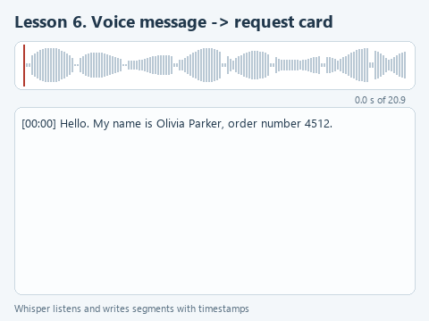

# Lesson 6. Transcribing a voice message

[Lesson source files](../exercises/lesson-06-speech/README.md) / [Hints next to the code](../exercises/lesson-06-speech/TASK.md)

> **Where we are.** A customer left a voice message. Whisper turns it into text with time marks, and the language model fills in a request card from the text. Today we write `transcribe`, which builds the lines of the transcript.
> **From the main course:** checking a model's answer against the source; the source is now a sound recording.
> **New:** a speech recognition model, sound as a sequence of numbers, a chain of two models.
> `call.wav -> read_wav -> numbers -> [transcribe: Whisper] -> lines with time -> call_card: Qwen3 + schema -> card`

Online store customers leave voice messages: in a messenger or on the answering machine after working hours. In the morning an operator listens to each one and writes down the name, the order number, the problem and when to call back. A half-minute message takes a minute of work, and there are dozens of them.

Let us build a program that prepares the request card itself. Such systems already work in companies. An analyst at YooMoney describes in [an article on call transcription](https://habr.com/ru/post/896096/) (in Russian) how Whisper transcribes calls to the call center for a dashboard of frequent user problems. An author with the nickname SmartAgent compared recognition on 200 phone recordings in [an article on the "call -> JSON" chain](https://habr.com/ru/articles/1020632/) (in Russian): a local Whisper large-v3 got 14.2% of words wrong, the cloud Yandex SpeechKit 8.1%. The same article notes an important property of Whisper: it does not mark an unclear place but replaces it with plausible yet wrong text.

## Whisper on the processor

Whisper is an open-weights speech recognition model from OpenAI. For the processor its whisper.cpp implementation is convenient; it comes from the same family as llama.cpp, and Python reaches it through the `pywhispercpp` library. The model files are in the [whisper.cpp repository](https://huggingface.co/ggerganov/whisper.cpp).

We take the small model, the file `ggml-small.bin` of about 490 MB: it understands many languages, including English. Whisper small transcribed our 21-second recording in about two seconds on the computer where the course was checked, and wrote the order number "four five one two" as "4512".

## Open the starter

Download [the lesson archive](../downloads/lesson-06-speech.zip?raw=true), open the `lesson-06-speech` folder in PyCharm and choose the shared course environment. Install the dependencies; `pywhispercpp` is added to the earlier ones:

```powershell
python -m pip install --only-binary=:all: -r requirements.txt
```

Run `get_models.py`: it downloads Whisper small and takes the already downloaded language model.

| File | What is in it |
|---|---|
| `data/call.wav` | The customer's voice message, 21 seconds |
| `speech.py` | Reading the sound, transcription and the request card. We write `transcribe` here |
| `demo_check.py` | A check of the function on a stand-in model |
| `demo.py` | Transcription with the real Whisper and a card from Qwen3 |

We synthesized `call.wav` with a Windows voice so as not to use anyone's real voice. The speech in it is clean and even; on real calls with noise Whisper makes more mistakes.

## How sound becomes numbers

A microphone measures air pressure many times a second, and sound is stored as a sequence of these measurements - samples. Whisper expects 16,000 samples per second, one channel (mono), and each sample is an integer from -32768 to 32767. The ready function `read_wav` opens the file with the `wave` module from the standard library, checks these three conditions and divides the numbers by 32768 to get fractions from -1 to 1. For our recording that gives 334,640 numbers: 20.9 seconds times 16,000.

Whisper returns the transcript in pieces - segments of speech. Each segment has a start `t0`, an end `t1` and text:

```python
Segment(t0=744, t1=1164, text=' Two weeks ago I bought an electric kettle from you,')
```

The time here is in hundredths of a second: 744 is 7.44 seconds. The text starts with a space; that is a quirk of Whisper.



[Static version](../assets/lesson-06-speech.png).

## Your turn

`transcribe` receives the loaded Whisper model and the sound as numbers and has to return lines like `[00:07] Two weeks ago...`. The time mark is for the operator: with it they can quickly find the place in the recording and listen again. Replace the line `raise NotImplementedError(...)` with the fragment below and fill in the three gaps:

```python
    segments = model.transcribe(..., language='en')
    lines = []
    for segment in segments:
        seconds = ...
        lines.append(f'[{seconds // 60:02}:{seconds % 60:02}] {...}')
    return lines
```

1. Pass `audio` to `model.transcribe`.
2. Store `segment.t0 // 100` in `seconds`: integer division turns hundredths into whole seconds, so 744 becomes 7.
3. Put `segment.text.strip()` in the curly braces at the end of the line: `strip` removes the space at the start of the text.

`seconds // 60` gives whole minutes, `seconds % 60` the remaining seconds. `:02` inside the f-string pads the number with a zero to two digits, so 7 seconds become `00:07`. The `language='en'` parameter tells Whisper the language of the speech; we will see below what happens with the wrong one.

## Guess before running

The customer says the order number in words: "four five one two". How will Whisper write it in the transcript? And how will the language model fill in the `wish` field of the card, when the schema allows only "refund", "exchange", "repair", "advice" and "other" for it?

## Run it

Open `demo_check.py` and choose **Run 'demo_check'**. The stand-in model returns two ready segments, and the check looks at the time marks and the language. Once the function is done:

```text
Offline check: [00:07] Two weeks ago I bought an electric kettle from you,
```

Now **Run 'demo'**. First Whisper loads and the transcript appears, then Qwen3 loads and fills in the card. When the course was prepared:

```text
Recording length: 20.9 s
Transcribed in 2.3 s:
[00:00] Hello. My name is Olivia Parker, order number 4512.
[00:06] Two weeks ago I bought an electric kettle from you, and yesterday it stopped switching on.
[00:12] I would like my money back.
[00:15] I still have the receipt.
[00:17] Please call me back after six in the evening.
Request card: {'name': 'Olivia Parker', 'order': '4512', 'problem': 'electric kettle stopped switching on', 'wish': 'refund', 'callback': 'after six in the evening'}
```

The ready function `call_card` builds the card: it passes the transcript lines to `ask` with the rule `CALL_RULE` and the schema `CALL_SCHEMA`. The models are loaded one after another in separate `with` blocks, so only one of them is in memory at a time.

## Try to break it

**Name the wrong language.** In the `model.transcribe` call replace `language='en'` with `language='de'` and run `demo.py`. When the course was prepared, Whisper started in German, "Hallo. Mein Name ist Olivia Parker, Order #4512", and went on in English. With `language='ru'` it translated the whole message into Russian and lost the meaning on the way: "I still have the receipt" turned into "I still can't". The language model would fill in the card from such a text without noticing anything. Put `language='en'` back.

**Simplify the card rule.** In `CALL_RULE` delete the sentence that explains the `name`, `order`, `problem` and `callback` fields. When the course was prepared, without it the card was still filled in, but the `callback` field lost a word: "six in the evening" or "6pm" instead of "after six in the evening". For the operator that is a different instruction. Explaining the fields works the same way as explaining the categories in lesson 2. Put the sentence back.

**Record your own message.** The Windows Sound Recorder app saves files as m4a, and `read_wav` answers with the error `A WAV file is needed: 16,000 Hz, one channel, 16 bits`. If you have ffmpeg installed, convert the recording with the command below and point `demo.py` to the new file:

```powershell
ffmpeg -i recording.m4a -ar 16000 -ac 1 data\my.wav
```

## What we have now

Two models work as a chain: Whisper turns sound into text with time marks, and Qwen3 turns the text into a card by a schema. An error at the first step passes into the second, so the operator sees the card next to the transcript with the time marks that let them listen to the recording again.

Next: [lesson 7. A Telegram bot on a local model](07-telegram-bot.md).
