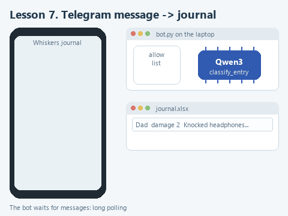

# Lesson 7. A Telegram bot on a local model

[Lesson source files](../exercises/lesson-07-telegram-bot/README.md) / [Hints next to the code](../exercises/lesson-07-telegram-bot/TASK.md)

> **Where we are.** The cat journal from lesson 2 gets a Telegram bot: family members send it entries, and it sorts them with the local model and writes them to the same Excel file. Today we write `handle_text`, which decides what the bot replies.
> **From the main course:** the program's access rule is written in code, not in a prompt; a separate check of logic without a network.
> **New:** the Telegram Bot API, long polling, a token outside the code, an allow list of users.
> `Telegram message -> bot.py -> allow list -> handle_text -> classify_entry -> Excel journal -> reply in the chat`

In lesson 2 the Whiskers journal was kept in Excel on one computer. Not convenient: Grandma sees the mischief in the kitchen, while the laptop is in Emma's room. Let the entries arrive through Telegram: whoever saw it writes to the bot, and the bot sorts the entry with the model, adds it to the journal and replies with the category. On the `/summary` command the bot sends a bulletin.

A bot on a local model is a popular home project. An author with the nickname rocet tells in [an article on Habr](https://habr.com/ru/articles/1008248/) (in Russian) how he grew such a bot from a simple chat partner to mini-games. His problems are familiar: the bot works only while his home computer is on; the model stubbornly answered with LaTeX formulas that Telegram does not display, prompt requests did not help, and he had to clean the answer with regular expressions; long answers did not fit into Telegram's 4096-character limit. Our bot's answers are short and assembled by the program, but the first limitation is the same: the bot works while `bot.py` is running.

## How the bot receives messages

A Telegram bot is a special account controlled by a program. The program talks to Telegram's servers through the Bot API, and access to it is given by a token - a string like `1234567890:AA...`. The token is as good as a password: whoever knows it controls the bot.

Our bot uses long polling: the program itself asks Telegram's servers whether there are new messages and waits for an answer for up to several tens of seconds. When a message arrives, the server hands it over immediately, the program handles it and asks again. No public address or open ports are needed: the laptop only needs internet access. If the program was off, Telegram keeps new messages for the bot for up to 24 hours and hands them over at the next start.

For an administrator the boundary matters here: the model runs on your laptop, but the messages themselves pass through Telegram's servers. For a cat journal that is no problem; work data should be sent through such a bot only if that is allowed.

## Create the bot

1. In Telegram find `@BotFather` - the official bot for creating bots, with a blue check mark.
2. Send it `/newbot`. When asked for a name, answer, for example, `Whiskers journal` - this name is shown in the chat.
3. Then make up the bot's address in Latin letters; it must end with `bot`, for example `whiskers_journal_2026_bot`. If the address is taken, BotFather asks for another.
4. BotFather sends a message with the token. Copy the token and never forward it to anyone. If it leaks anyway, send BotFather `/revoke`, choose the bot and get a new one.

## The token outside the code

The token must not be written into `bot.py`: the file ends up in an archive, a repository, a screenshot in a chat with a colleague. We save it in a separate folder outside the project:

1. In File Explorer open your user folder `C:\Users\Name` and create an `agent-secrets` folder in it.
2. Open Notepad, paste the token as a single line and save the file to this folder as `telegram_token.txt`. In "Save as type" choose "All files", so Notepad does not add a second extension.

The ready function `read_token` in `bot.py` first looks at the `TELEGRAM_BOT_TOKEN` environment variable and, if it is not set, reads this file. If it finds neither, the program stops and tells you where to put the token.

## Open the starter

Download [the lesson archive](../downloads/lesson-07-telegram-bot.zip?raw=true), open the `lesson-07-telegram-bot` folder in PyCharm and choose the shared course environment. Install the dependencies; the `pyTelegramBotAPI` library is added to the earlier ones:

```powershell
python -m pip install --only-binary=:all: -r requirements.txt
```

| File | What is in it |
|---|---|
| `bot_logic.py` | What to reply to a message. Nothing from Telegram here. We write `handle_text` here |
| `bot.py` | Connecting to Telegram: token, handlers, long polling |
| `journal_ai.py`, `journal_io.py` | Sorting an entry and working with Excel from lesson 2, already done |
| `data/journal.xlsx` | The journal with the twelve entries from lesson 2 |
| `data/allowed_users.txt` | The allow list: who may write to the journal |
| `demo_check.py` | A check of the function on a stand-in model |
| `demo.py` | A conversation with the bot without Telegram, on the real model |

## How bot.py is built

Open `bot.py`. The bot object is created in one line:

```python
bot = telebot.TeleBot(read_token(), threaded=False)
```

Then come the handlers - functions the library calls on a new message:

```python
@bot.message_handler(commands=['id'])
def send_id(message):
    bot.reply_to(message, f'Your id: {message.from_user.id}')
```

The line with `@` above the function is a decorator: it registers the function as the handler of the `/id` command. The library passes the message with all its details in `message`: the text, the chat, the sender. `bot.reply_to` sends a reply to this message. Handlers are checked in the order they are declared, so the commands are declared before the general text handler `content_types=['text']`, which catches everything else.

`bot.infinity_polling()` at the end starts the endless long polling loop. `threaded=False` makes messages be handled one at a time: we have one model, and it does not need two simultaneous calls.

## The allow list

Anyone who guesses the bot's address can find it in Telegram. So only people from the `data/allowed_users.txt` file add to the journal: it holds Telegram user numbers, one per line. This id is the permanent number of the account; it does not change when the name changes. Everyone can find their id with the `/id` command. The `/summary` and text handlers first compare `message.from_user.id` with the list and politely refuse strangers.

Who can do what with the bot is decided by whoever keeps this file - in a family the owner of the laptop, in a company the administrator. The rule is written in code, and no chat message will change it.

## Your turn

Open `bot_logic.py`. `handle_text` receives the model, the journal path, the author's name and the message text. The checks for an empty and a too-long text are already there: a long text never reaches the model. Replace the line `raise NotImplementedError(...)` with the fragment below and fill in the two gaps:

```python
    entry = classify_entry(model, ...)
    append_entry(journal_path, author, text, extra=(entry['category'], entry['severity']))
    return f'Recorded in the journal: {entry["category"]}, severity {...}.'
```

1. Pass `text` to `classify_entry`. This is the same function from lesson 2; here it is already done.
2. In the reply after the word "severity" put `entry["severity"]` - with double quotes, because the whole f-string is in single quotes.

`append_entry` from `journal_io.py` adds a row to the end of the journal with today's date, the author and the text, and through `extra` the category and severity go into columns D and E. The utility from lesson 2 reads the first three columns, so it opens the extended journal without changes.

## Guess before running

What will the bot answer if a family member writes to it "What's the weather tomorrow?" by mistake? And what will a person not on the allow list see?

## Run it without Telegram

Open `demo_check.py` and choose **Run 'demo_check'**. The check works with a copy of the journal in a temporary folder and a stand-in model, so the real journal does not change. Once the function is done:

```text
Offline check: Recorded in the journal: kitchen, severity 1.
```

Now **Run 'demo'**. This is a conversation with the bot without Telegram: two entries from Emma and Dad and the `/summary` command, and the journal is a copy, `data/demo-journal.xlsx`. When the course was prepared:

```text
Emma: Grabbed a sausage off the table while I was pouring tea
Bot: Recorded in the journal: kitchen, severity 2.
Dad: Knocked my headphones off the shelf, an ear cushion broke off
Bot: Recorded in the journal: damage, severity 2.
Bot on /summary: Latest entries by category: {'kitchen': 1, 'damage': 1}
```

The bulletin from the model follows the count. Read it critically: in our run the model added details that are not in the entries, such as "a smudge of meat on the counter". The rule "add nothing of your own" does not fully hold for a small model, which is one more reason the bot records the category from the schema and shows the bulletin only as entertainment. `demo.py` calls the same functions as `bot.py`, so before meeting Telegram we already know the bot's logic works.

## Run it in Telegram

1. Open `bot.py` and choose **Run 'bot'**. The model loads, and Run shows `Bot started, allowed users: 0`.
2. In Telegram open your bot at the address you gave in BotFather and press **Start**. The bot replies with the help text.
3. Send `/id`. The bot sends your number.
4. Stop the bot with **Stop**, open `data/allowed_users.txt` and add the number on a new line. The list is read at startup, so run `bot.py` again.
5. Write a piece of mischief to the bot, for example "Stole a piece of cheese from my sandwich". While the model is thinking, the chat shows "typing...", then the reply with the category arrives.
6. Send `/summary` and get the bulletin. Open `data/journal.xlsx` in Excel - the new entries are at the end of the sheet. Close the file in Excel before the next entry: while it is open, Windows will not let the program overwrite it, and the bot will ask you to close the journal.

For the bot to add to the journal, the laptop must be on and `bot.py` running.

## Try to break it

**Write about something other than the cat.** Send "What's the weather tomorrow?". When the course was prepared, the model filed "What's the weather tomorrow?" under noise and "Remind me to buy milk" under affection: the schema allows only five categories, and the model has to pick one of them. To keep the bot from cluttering the journal, you can add a sixth category to `CATEGORIES`, for example "not about the cat", and not record such messages in `handle_text`. Try doing it yourself.

**Write from someone else's account.** Ask somebody to write to the bot. They get a refusal and the hint about `/id`, and the journal does not change.

**Switch the bot off.** Stop `bot.py`, send it a couple of messages and start it again. The bot handles them after the start: Telegram kept them all that time.

## What we have now

The bot receives messages from the family, lets only people from the allow list into the journal, sorts the entries with the same model as the utility from lesson 2 and writes to the same Excel file. The bot's logic is kept separate from Telegram, so it can be checked without a network, and the token is stored outside the project.



[Static version](../assets/lesson-07-bot.png).

Next: [conclusion](conclusion.md).
